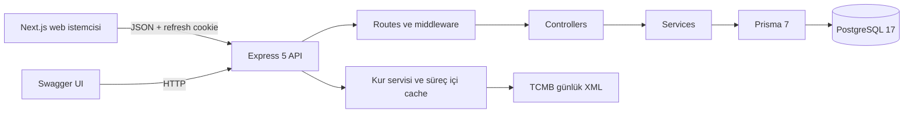
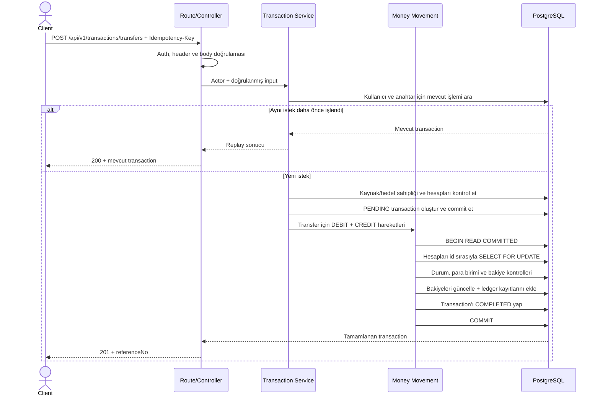

# FinTrack Mimarisi

## Sistem özeti

FinTrack; müşteri hesapları, TRY/USD/EUR bakiyeleri, para yatırma/çekme,
hesaplar arası transfer ve finansal raporlama sağlayan bir uygulamadır. Web
istemcisi Next.js ve React ile, API Node.js, Express 5 ve Prisma 7 ile
geliştirilmiştir. PostgreSQL 17; hesap bakiyelerinin, işlem durumlarının ve
append-only ledger kayıtlarının kalıcı kaynağıdır.

TCMB'den alınan USD/EUR kurları yalnızca bilgilendirme amaçlıdır. Kur bilgisi
para hareketlerinde kullanılmaz; farklı para birimindeki hesaplar arasında
dönüşüm yapılmaz.



## Katmanlar

| Katman                | Sorumluluk                                                       |
| --------------------- | ---------------------------------------------------------------- |
| Web feature'ları      | Ekranlar, feature API fonksiyonları ve TanStack Query hook'ları  |
| API routes/middleware | URL'ler, kimlik doğrulama, rol kontrolü ve rate limit            |
| Controllers           | HTTP isteklerini Zod ile doğrulama; status ve response envelope  |
| Services              | İş kuralları, sahiplik kontrolleri ve Prisma çağrıları           |
| Money movement        | Hesap kilitleri, bakiye kontrolleri, bakiye ve ledger yazımları  |
| Prisma/PostgreSQL     | Kalıcı veri, foreign key, unique/check constraint ve trigger'lar |
| Shared package        | API ve web arasında ortak Zod şemaları ve tipler                 |

Controller'lar iş mantığını veya doğrudan SQL'i taşımaz. Para ve rapor sorgularında
Prisma'nın ifade edemediği `SELECT ... FOR UPDATE`, `SUM ... FILTER` ve
`date_trunc` işlemleri parametreli raw SQL olarak kullanılır. Hatalar
`AppError` ile taşınır ve merkezi error handler tarafından sabit API
formatına dönüştürülür.

## Veri modeli

```mermaid
erDiagram
    USER ||--o| CUSTOMER : profile
    USER ||--o{ REFRESH_TOKEN : owns
    USER ||--o{ MONEY_TRANSACTION : initiates
    CUSTOMER ||--o{ ACCOUNT : owns
    ACCOUNT o|--o{ MONEY_TRANSACTION : source_account
    ACCOUNT o|--o{ MONEY_TRANSACTION : target_account
    ACCOUNT ||--o{ LEDGER_ENTRY : has
    MONEY_TRANSACTION ||--o{ LEDGER_ENTRY : records

    USER {
        uuid id PK
        string email UK
        string password_hash
        enum role
    }
    CUSTOMER {
        uuid id PK
        uuid user_id FK_UK
        string national_id UK
        enum status
    }
    ACCOUNT {
        uuid id PK
        uuid customer_id FK
        string account_number UK
        enum currency
        decimal balance
        enum status
    }
    MONEY_TRANSACTION {
        uuid id PK
        string reference_no UK
        enum type
        enum status
        decimal amount
        uuid source_account_id FK
        uuid target_account_id FK
        string idempotency_key
        string request_hash
        uuid initiated_by_id FK
    }
    LEDGER_ENTRY {
        uuid id PK
        uuid transaction_id FK
        uuid account_id FK
        enum direction
        decimal amount
        decimal balance_after
    }
    REFRESH_TOKEN {
        uuid id PK
        uuid user_id FK
        string token_hash UK
        datetime expires_at
        datetime revoked_at
    }
```

### Veri tutarlılığı

- Tutarlar API'de decimal string, uygulama kodunda `Prisma.Decimal`, veritabanında
  `NUMERIC(19,2)` olarak tutulur. Para hesabında JavaScript `number` kullanılmaz.
- `accounts.balance` hızlı okuma için güncel bakiyeyi tutar. Mutasyonların
  denetim izi `ledger_entries` tablosudur; beklenen invariant
  `balance = SUM(CREDIT) - SUM(DEBIT)` şeklindedir.
- Ledger kayıtları yalnızca eklenir. Veritabanı trigger'ı ledger üzerinde
  `UPDATE` ve `DELETE` işlemlerini reddeder. İşlemler silinmez; durum ve hata
  alanları güncellenebilir.
- DB constraint'leri negatif bakiyeyi, pozitif olmayan işlem tutarını ve işlem
  türüne uymayan kaynak/hedef hesap kombinasyonlarını engeller.
- Müşteri ve hesaplar fiziksel olarak silinmez; `ACTIVE/PASSIVE` durumuyla
  yönetilir. Finansal geçmiş böylece referanslarını korur.

## Transfer akışı



İstek başlamadan önce kimlik doğrulama, Zod doğrulaması ve sahiplik kontrolleri
yapılır. Kaynak hesabı müşterinin değilse kaynak varlığını açığa çıkarmamak için
`404` döndürülür. Yeni işlem önce `PENDING` olarak kalıcılaştırılır; para hareketi
ayrı bir DB transaction'ında yürütülür. Böylece iş kuralı hatasında hareket
transaction'ı rollback olurken işlem `FAILED` ve hata nedeni ile kaydedilebilir.
Bir dakikadan eski `PENDING` kayıtlarını başarısız duruma çeviren cleanup da
vardır.

### Kilit ve eşzamanlılık stratejisi

Transferde kaynak ve hedef hesap satırları tek transaction içinde
`SELECT ... FOR UPDATE` ile kilitlenir. Birden fazla hesap her zaman `id`
sırasıyla kilitlendiğinden A→B ve B→A işlemleri aynı kilit sırasını izler; bu,
karşılıklı transferlerin deadlock üretmesini önler. Bakiye yeterliliği ve hesap
durumu kilit alındıktan sonra okunur; kontrol, bakiye güncellemesi, ledger
insert'leri ve `COMPLETED` geçişi aynı transaction içindedir.

İşlem `READ COMMITTED` kullanır; transaction timeout'u 10 saniye, bağlantı
bekleme sınırı 5 saniye, satır kilidi bekleme sınırı 5 saniyedir. Uygulama
kilidinin yanında DB `CHECK (balance >= 0)` constraint'i son savunma katmanıdır.

`SERIALIZABLE` yerine açık satır kilidi seçildi: bu iş yükünde hangi hesapların
kilitlendiği bellidir ve serialization failure için genel retry döngüsü
gerektirmez. Optimistic locking, yüksek çakışmada sık retry ister; yalnızca
koşullu `UPDATE` ise transferin iki hesap ve ledger tutarlılığını açıklamayı
zorlaştırır.

## Idempotency

Para hareketi endpoint'leri UUID biçiminde `Idempotency-Key` ister. Veritabanında
`(initiated_by_id, idempotency_key)` unique'tir. API istek türü ve sıralanmış
payload üzerinden SHA-256 `request_hash` üretir:

- Aynı kullanıcı, anahtar ve payload tekrar gelirse önceki işlem döner; yeni
  bakiye hareketi yapılmaz (`200` replay).
- Aynı anahtar farklı payload ile kullanılırsa
  `409 IDEMPOTENCY_KEY_REUSED` döner.
- Eşzamanlı aynı anahtar isteklerinde unique constraint ikinci kaydı engeller;
  servis ilk işlemi bulup replay eder.

Bu mekanizma istemcide çift tıklama veya ağ tekrarına karşı koruma sağlar;
bakiye kilidi ve DB transaction'ının yerine geçmez.

## Tasarım ödünleri ve kapsam

| Karar                             | Neden ve etkisi                                                                                                                                                             |
| --------------------------------- | --------------------------------------------------------------------------------------------------------------------------------------------------------------------------- |
| Sistem/kasa hesabı yok            | Deposit ve withdrawal yalnızca müşteri hesabındaki hareketi modeller. Gerçek kurum muhasebesindeki karşı taraf hesabı ve kurum düzeyinde dengeli çift kayıt kapsam dışıdır. |
| Offset sayfalama                  | API'de sayfa numarası ve toplam kayıt sayısını basitçe sağlar; derin sayfalarda önceki satırları tarama maliyeti artar.                                                     |
| Bellek içi rate limit             | Tek API instance'ında yeterlidir ve ek servis gerektirmez; limit sayaçları process'ler arasında paylaşılmaz ve yeniden başlatmada sıfırlanır.                               |
| TCMB kurları bilgilendirme amaçlı | Günlük referans kurları 15 dakikalık süreç içi cache ile sunulur; transfer ve bakiyelerde kur dönüşümü yapılmaz.                                                            |
| Arka plan kuyruğu/realtime yok    | Ödev kapsamındaki işlemler senkrondur; ayrı worker veya WebSocket altyapısı operasyonel karmaşıklık ekleyeceği için eklenmemiştir.                                          |

## Performans ölçümü

T7.3 ölçümünde PostgreSQL 17 üzerinde tek hesaba ait 100.000 transaction ve
100.000 ledger entry kullanıldı. Hesap geçmişi sorgusu
`ledger_entries_account_id_created_at_idx` indeksini kullandı:

| İstek                                 | Plan       |      Süre | Shared buffer hit | Önünden geçilen satır |
| ------------------------------------- | ---------- | --------: | ----------------: | --------------------: |
| İlk sayfa (`LIMIT 20 OFFSET 0`)       | Index Scan |  0.125 ms |                 4 |                     0 |
| 4000. sayfa (`LIMIT 20 OFFSET 79980`) | Index Scan | 21.901 ms |             1,699 |                80,000 |

Bu tek ölçümde derin offset sayfası ilk sayfadan yaklaşık 175 kat yavaştı.
Süreler cache ve makine koşullarına bağlıdır; benchmark, üretim kapasitesi
garantisi değildir.

## Ölçekleme yönü

1. Derin hesap geçmişi için `(created_at, id)` cursor tabanlı keyset sayfalama
   eklemek; cursor sıralamasıyla uyumlu indeks ve kararlı sıralama kullanmak.
2. Birden fazla API instance'ında rate-limit sayaçlarını API gateway veya
   paylaşımlı bir store üzerinden ortaklaştırmak. Mevcut bellek store'u yalnızca
   tek instance için uygundur.
3. Rapor yükü büyürse sorgu planlarını ve indeksleri yeniden ölçmek; gerekirse
   read replica veya önceden hesaplanmış günlük özetler kullanmak.
4. PostgreSQL connection pool ve API instance sayısını birlikte ayarlamak.
   Aynı hesabın tek satır kilidinde sıraya girmesi doğal bir darboğazdır; sıcak
   hesaplar için kuyruk veya alt hesap gibi seçenekler ancak muhasebe
   invariants'ları korunarak tasarlanmalıdır.
5. Çoklu instance'ta TCMB cache'ini ortaklaştırmak ve kaynağın kesintisinde
   eski verinin `isStale` olarak sunulması davranışını korumak.
6. Gerçek kurum muhasebesine geçilecekse sistem/kasa hesaplarını ve her
   transaction için dengeli çift kayıtları eklemek; mevcut demo modelini
   doğrudan gerçek muhasebe defteri olarak değerlendirmemek.
