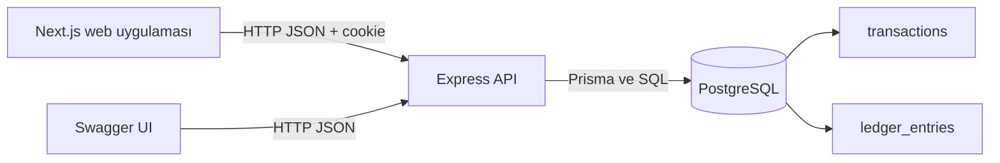
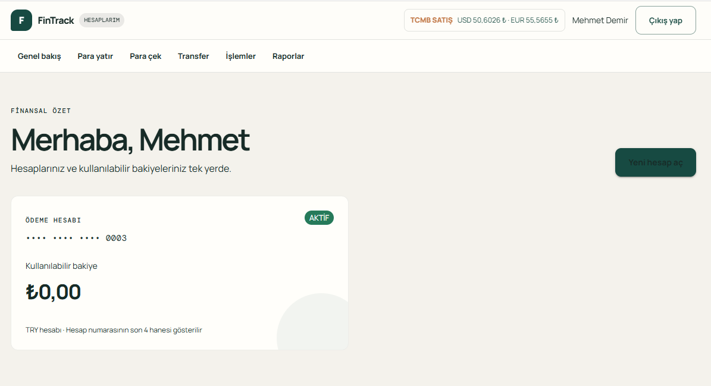
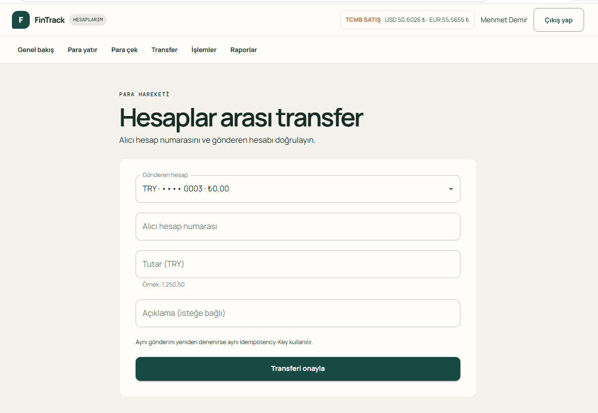
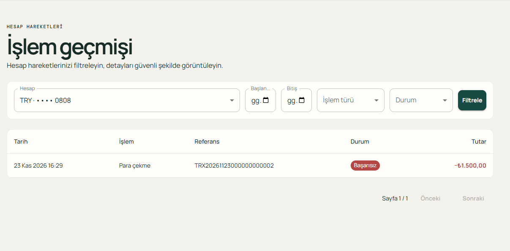
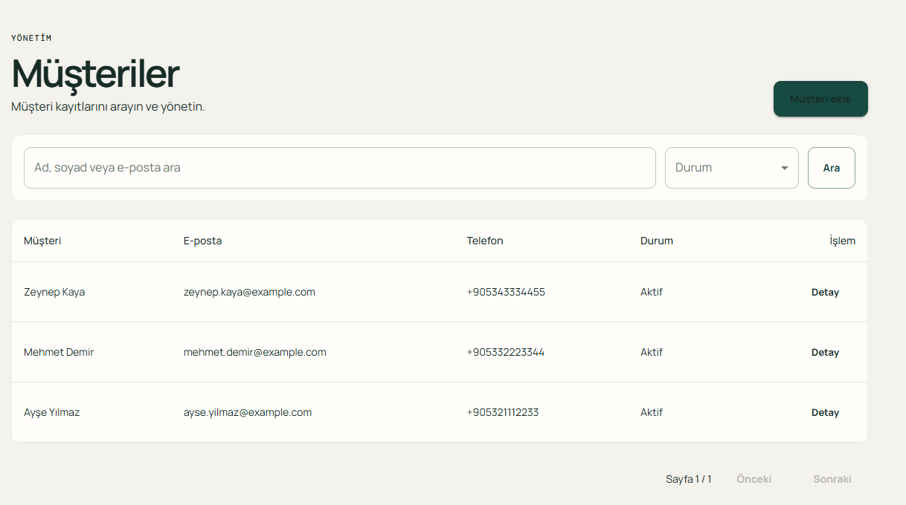
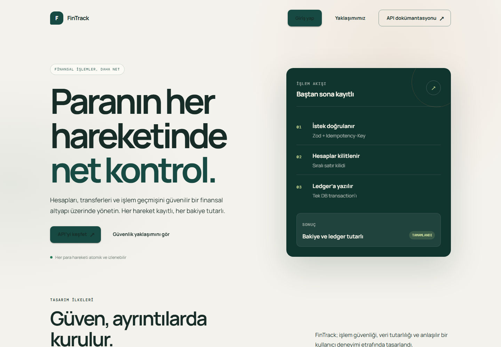
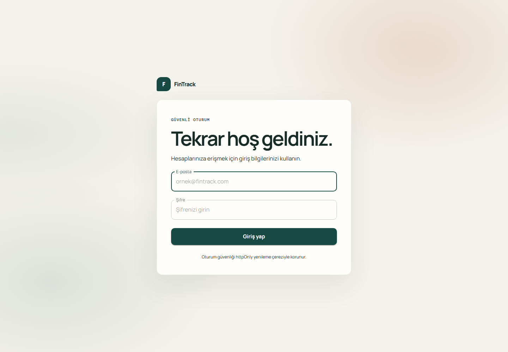

# FinTrack

FinTrack; müşteri hesaplarını, para yatırma/çekme ve transfer işlemlerini, finansal raporları sunan TypeScript tabanlı bir finans platformudur. Backend API ve rol tabanlı web arayüzü, YUI Teknoloji teknik ödevi kapsamında geliştirilmiştir.

## Teknolojiler

| Katman              | Teknoloji                                 |
| ------------------- | ----------------------------------------- |
| Dil                 | TypeScript (strict)                       |
| Backend             | Node.js 22, Express 5, Prisma 7, Zod 4    |
| Frontend            | Next.js App Router, React 19, MUI         |
| İstemci veri/oturum | TanStack Query, Axios, Zustand            |
| Veritabanı          | PostgreSQL 17                             |
| Kimlik doğrulama    | JWT access token, httpOnly refresh cookie |
| Loglama             | Pino                                      |
| API dokümantasyonu  | OpenAPI 3, Swagger UI                     |
| Test                | Vitest, Supertest (API)                   |
| Altyapı             | Docker, Docker Compose                    |

## Mimari



API katmanları `routes -> controller -> service -> Prisma` şeklindedir. Para hareketleri veritabanı transaction'ı ve hesap satırı kilitleriyle yürütülür; `ledger_entries` append-only işlem geçmişidir.

## Özellikler

- JWT access token ve hash'lenmiş refresh token cookie ile kimlik doğrulama
- Admin ve müşteri rolleri için yetkilendirme ve kaynak sahipliği kontrolleri
- TRY, USD ve EUR cinsinden hesaplar
- Idempotency anahtarı korumalı para yatırma, para çekme ve transfer
- Tür, durum, tarih aralığı ve başarısızlık nedenlerine göre raporlar
- Müşteri, hesap ve işlem endpoint'leri için sayfalama ve filtreleme
- IP ve kullanıcı bazlı rate limit
- Eski `PENDING` işlemleri `FAILED / STALE_PENDING` olarak işaretleyen cleanup
- Swagger UI üzerinden etkileşimli API dokümantasyonu
- Müşteri ve yönetici iş akışları için Next.js web uygulaması
- Türkçe tutar/telefon biçimlendirmesi ve merkezi API istemcisi
- Navbar üzerinden TCMB USD/EUR günlük gösterge kurları (işlem kuru değildir)

## Ekran görüntüleri

### Müşteri paneli

Hesap ve bakiye özeti:



Transfer formu:



İşlem geçmişi:



### Yönetici paneli



### Herkese açık ekranlar

| FinTrack ana sayfası                                 | Giriş ekranı                                           |
| ---------------------------------------------------- | ------------------------------------------------------ |
|  |  |

## Gereksinimler

- Node.js 22 veya üzeri
- npm
- Docker ve Docker Compose

## Hızlı başlangıç

Gereksinimler: Node.js 22+, npm ve Docker Compose.

### 1. Ortamı hazırla

Temiz checkout'ta örnek ortam dosyalarını kopyala. Dosyalar varsa üzerine yazma; eksik değişkenleri mevcut dosyalara ekle.

```cmd
copy .env.example .env
copy apps\api\.env.example apps\api\.env
copy apps\web\.env.example apps\web\.env.local
npm install
```

### 2. Veritabanını hazırla

```cmd
docker compose up -d
npm run db:migrate -w apps/api
npm run db:seed -w apps/api
```

`apps/api/.env` içindeki `DATABASE_URL` yerel geliştirmede `localhost` hostunu kullanmalıdır. Kök `.env` dosyasındaki PostgreSQL kullanıcı adı, parola, veritabanı ve portla eşleştir.

### 3. Uygulamaları başlat

İki terminal kullan:

```cmd
npm run dev:api
```

```cmd
npm run dev
```

Web uygulaması `http://localhost:3000`, API `http://localhost:3001` adresinde çalışır. `NEXT_PUBLIC_API_URL` API'nin `/api/v1` adresini, API'deki `WEB_URL` ise web origin'ini göstermelidir; refresh cookie istekleri CORS ayarına bağlıdır.

## Web ekranları

- `/login`: yönetici veya müşteri girişi.
- `/dashboard`: rol kapsamına göre hesaplar; müşteriler kendi hesaplarını görür, yöneticiler tüm hesapları görür.
- `/dashboard/accounts/new`: müşteri hesabı açma.
- `/dashboard/deposit`, `/dashboard/withdraw`, `/dashboard/transfer`: idempotent para hareketleri.
- `/dashboard/transactions` ve `/dashboard/reports`: hesap hareketleri, işlem detayı, raporlar ve ekstre.
- `/admin/customers`, `/admin/customers/new`, `/admin/customers/:id`: yönetici müşteri listesi, müşteri oluşturma ve profil/durum yönetimi.

### Yerel demo kullanıcıları

`npm run db:seed -w apps/api` komutu aşağıdaki kullanıcıları oluşturur. Parolalar `apps/api/.env` içindeki `SEED_ADMIN_PASSWORD` ve `SEED_CUSTOMER_PASSWORD` değerleridir; README'de parola paylaşılmaz.

| Rol      | E-posta                    |
| -------- | -------------------------- |
| Yönetici | `admin@fintrack.dev`       |
| Müşteri  | `ayse.yilmaz@example.com`  |
| Müşteri  | `mehmet.demir@example.com` |
| Müşteri  | `zeynep.kaya@example.com`  |

Bu hesaplar yalnızca yerel geliştirme içindir. Production Compose demo kullanıcılarını seed etmez. Para ve müşteri yetkileri API tarafından ayrıca doğrulanır; arayüzdeki rol koruması yalnızca gezinme deneyimini düzenler.

## API uç noktaları

Temel yol: `/api/v1`. Yerel API adresi: `http://localhost:3001/api/v1`. Para yatırma, çekme ve transfer isteklerinde `Idempotency-Key` zorunludur. Ayrıntılı şemalar ve istek örnekleri için [Swagger UI](http://localhost:3001/api/docs) sayfasını kullan.

| Metot      | Uç nokta                          | Erişim               | Açıklama                                   |
| ---------- | --------------------------------- | -------------------- | ------------------------------------------ |
| GET        | `/health`                         | Herkese açık         | API ve veritabanı sağlık kontrolü          |
| POST       | `/auth/login`                     | Herkese açık         | Oturum açma                                |
| POST       | `/auth/refresh`                   | Refresh cookie       | Access token yenileme                      |
| POST       | `/auth/logout`                    | Refresh cookie       | Oturumu kapatma                            |
| GET        | `/auth/me`                        | Bearer token         | Oturumdaki kullanıcı                       |
| GET, POST  | `/customers`                      | Admin                | Müşterileri listeleme ve oluşturma         |
| GET, PATCH | `/customers/:id`                  | Admin                | Müşteri detayını görüntüleme ve güncelleme |
| GET, POST  | `/accounts`                       | Bearer token         | Hesapları listeleme ve hesap açma          |
| GET        | `/accounts/:id`                   | Bearer token         | Hesap detayını görüntüleme                 |
| PATCH      | `/accounts/:id/status`            | Admin                | Hesap durumunu güncelleme                  |
| GET        | `/accounts/:id/transactions`      | Bearer token         | Hesap hareketlerini listeleme              |
| POST       | `/transactions/deposits`          | Bearer + idempotency | Para yatırma                               |
| POST       | `/transactions/withdrawals`       | Bearer + idempotency | Para çekme                                 |
| POST       | `/transactions/transfers`         | Bearer + idempotency | Hesaplar arası transfer                    |
| GET        | `/transactions/:id`               | Bearer token         | İşlem detayını görüntüleme                 |
| GET        | `/reports/summary`                | Bearer token         | Rapor özeti                                |
| GET        | `/reports/periodic`               | Bearer token         | Dönemsel rapor                             |
| GET        | `/reports/accounts/:id/statement` | Bearer token         | Hesap ekstresi                             |
| GET        | `/reports/transaction-stats`      | Bearer token         | İşlem istatistikleri                       |
| GET        | `/exchange-rates`                 | Bearer token         | TCMB USD/EUR gösterge kurları              |

## Production benzeri Docker ortamı

Temiz checkout'ta `.env.example` dosyasını `.env` olarak kopyala. Var olan `.env` dosyan varsa üzerine yazma; gereken değerleri dikkatlice birleştir. Gerçek ortamda örnek parolaları ve JWT secret'larını değiştir. `DATABASE_URL` içindeki parola `POSTGRES_PASSWORD` ile eşleşmelidir. Production'da `NEXT_PUBLIC_API_URL`, tarayıcının erişebildiği API adresini göstermelidir.

```cmd
docker compose --env-file .env -f compose.prod.yaml up --build -d
```

Web uygulaması `http://localhost:3000`, API `http://localhost:3001` adresinde kullanılabilir. Stack'i kontrol et ve logları izle:

```cmd
docker compose -f compose.prod.yaml ps
docker compose -f compose.prod.yaml logs -f api web
```

- Sağlık kontrolü: `http://localhost:3001/api/v1/health`
- Swagger UI: `http://localhost:3001/api/docs`

Bu yapılandırma API portunu yalnızca yerel makineye açar. Container'ları durdurmak, PostgreSQL volume'unu koruyarak:

```cmd
docker compose -f compose.prod.yaml down
```

Production Compose migration'ları uygular ancak demo kullanıcıları seed etmez. Örnek secret değerlerini gerçek bir sunucuda kullanma.

## Test ve kalite

```cmd
npm test
npm run typecheck
npm run lint
npm run build -w @fintrack/web
```

API testleri `fintrack_test` veritabanını kullanır. Test setup'ı bu test veritabanındaki tabloları her test öncesinde temizler; testleri çalıştırırken `fintrack` geliştirme veritabanı kullanılmaz.

## Proje yapısı

```text
apps/
  api/       Express API, Prisma şeması ve migration'lar
  web/       Next.js App Router, MUI ve feature tabanlı istemci kodu
packages/
  shared/    API ve web arasında paylaşılan Zod şemaları ve tipler
compose.yaml
compose.prod.yaml
```
