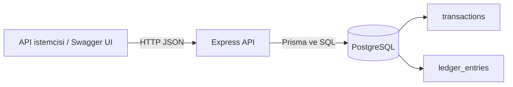

# FinTrack

FinTrack, müşteri hesapları, para yatırma/çekme, hesaplar arası transfer ve finansal raporlama sunan bir finansal işlem API'sidir. Proje, YUI Teknoloji teknik ödevi kapsamında hazırlanmıştır.

## Teknolojiler

| Katman             | Teknoloji                                 |
| ------------------ | ----------------------------------------- |
| Dil                | TypeScript (strict)                       |
| Backend            | Node.js 22, Express 5, Prisma 7, Zod 4    |
| Veritabanı         | PostgreSQL 17                             |
| Kimlik doğrulama   | JWT access token, httpOnly refresh cookie |
| Loglama            | Pino                                      |
| API dokümantasyonu | OpenAPI 3, Swagger UI                     |
| Test               | Vitest, Supertest                         |
| Altyapı            | Docker, Docker Compose                    |

## Mimari



API katmanları `routes -> controller -> service -> Prisma` şeklindedir. Para hareketleri veritabanı transaction'ı ve hesap satırı kilitleriyle yürütülür; `ledger_entries` append-only işlem geçmişidir.

## Özellikler

- JWT access token ve hash'lenmiş refresh token cookie ile kimlik doğrulama
- Admin ve müşteri rolleri için yetkilendirme ve kaynak sahipliği kontrolleri
- TRY, USD ve EUR cinsinden hesaplar
- Idempotency anahtarı korumalı para yatırma, para çekme ve transfer
- Tür, durum, tarih aralığı ve başarısızlık nedenlerine göre raporlar
- Müşteri, hesap ve işlem endpoint'leri için sayfalama ve filtreleme
- IP ve kullanıcı bazlı rate limit
- Eski `PENDING` işlemleri `FAILED / STALE_PENDING` olarak işaretleyen cleanup
- Swagger UI üzerinden etkileşimli API dokümantasyonu

## Gereksinimler

- Node.js 22 veya üzeri
- npm
- Docker ve Docker Compose

## Yerel geliştirme

Temiz checkout'ta ortam dosyalarını oluştur:

```cmd
copy .env.example .env
copy apps\api\.env.example apps\api\.env
```

Var olan `.env` dosyalarının üzerine yazma; eksik değişkenleri mevcut dosyaya ekle. `apps/api/.env` içindeki `DATABASE_URL` değerini, kök `.env` dosyasındaki PostgreSQL kullanıcı adı, parola, veritabanı ve portla eşleştir. Yerel API bağlantısında host `localhost` olmalı.

Bağımlılıkları kurup veritabanını başlat:

```cmd
npm install
docker compose up -d
npm run db:migrate -w apps/api
npm run db:seed -w apps/api
npm run dev:api
```

API varsayılan olarak `http://localhost:3001` adresinde çalışır. Yerel seed demo kullanıcılarını oluşturur; üretim Compose ortamı demo kullanıcılarını otomatik oluşturmaz.

## Production benzeri Docker ortamı

Temiz checkout'ta `.env.example` dosyasını `.env` olarak kopyala. Var olan `.env` dosyan varsa üzerine yazma; gereken değerleri dikkatlice birleştir. Gerçek ortamda örnek parolaları ve JWT secret'larını değiştir. `DATABASE_URL` içindeki parola `POSTGRES_PASSWORD` ile eşleşmelidir.

```cmd
docker compose -f compose.prod.yaml up --build
```

Stack'i kontrol et ve API loglarını izle:

```cmd
docker compose -f compose.prod.yaml ps
docker compose -f compose.prod.yaml logs -f api
```

- Sağlık kontrolü: `http://localhost:3001/api/v1/health`
- Swagger UI: `http://localhost:3001/api/docs`

Bu yapılandırma API portunu yalnızca yerel makineye açar. Container'ları durdurmak, PostgreSQL volume'unu koruyarak:

```cmd
docker compose -f compose.prod.yaml down
```

Production Compose migration'ları uygular ancak demo kullanıcıları seed etmez. Örnek secret değerlerini gerçek bir sunucuda kullanma.

## Test ve kalite

```cmd
npm test
npm run typecheck
npm run lint
```

API testleri `fintrack_test` veritabanını kullanır. Test setup'ı tabloları her test öncesinde temizler; mevcut test verisini koruman gerekiyorsa testleri çalıştırmadan önce kontrol et.

## Proje yapısı

```text
apps/
  api/       Express API, Prisma şeması ve migration'lar
  web/       Web uygulaması için ayrılmış workspace
packages/
  shared/    Ortak şemalar ve tipler için workspace
compose.yaml
compose.prod.yaml
```

Web arayüzü bu README sürümünde kapsam dışıdır; şu anki odak API ve üretim benzeri Docker ortamıdır.
